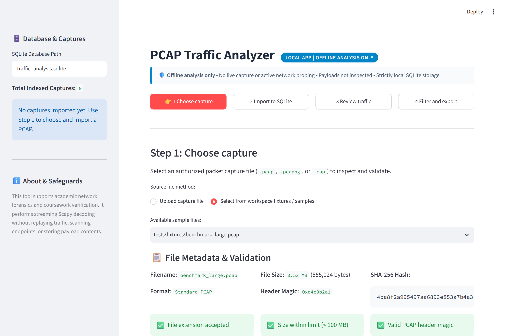
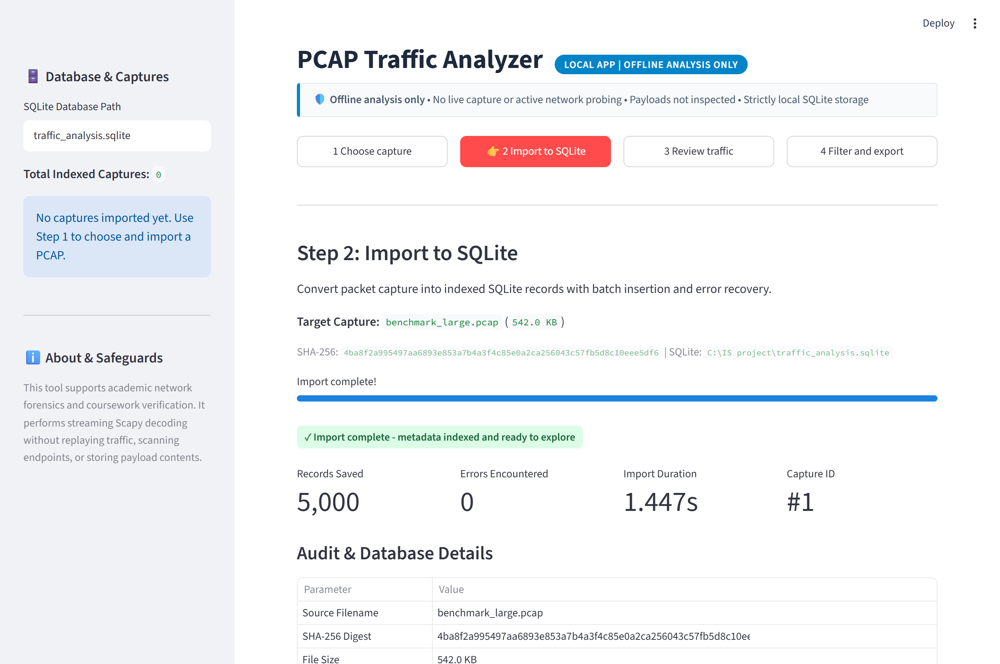
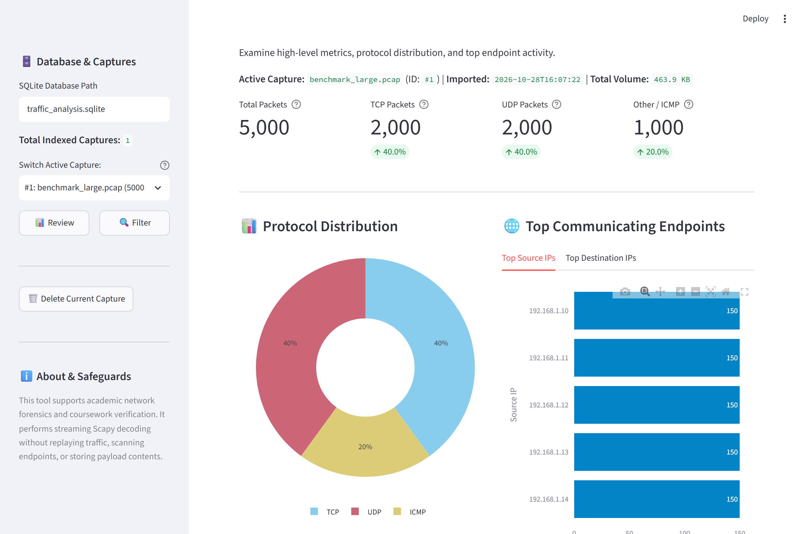
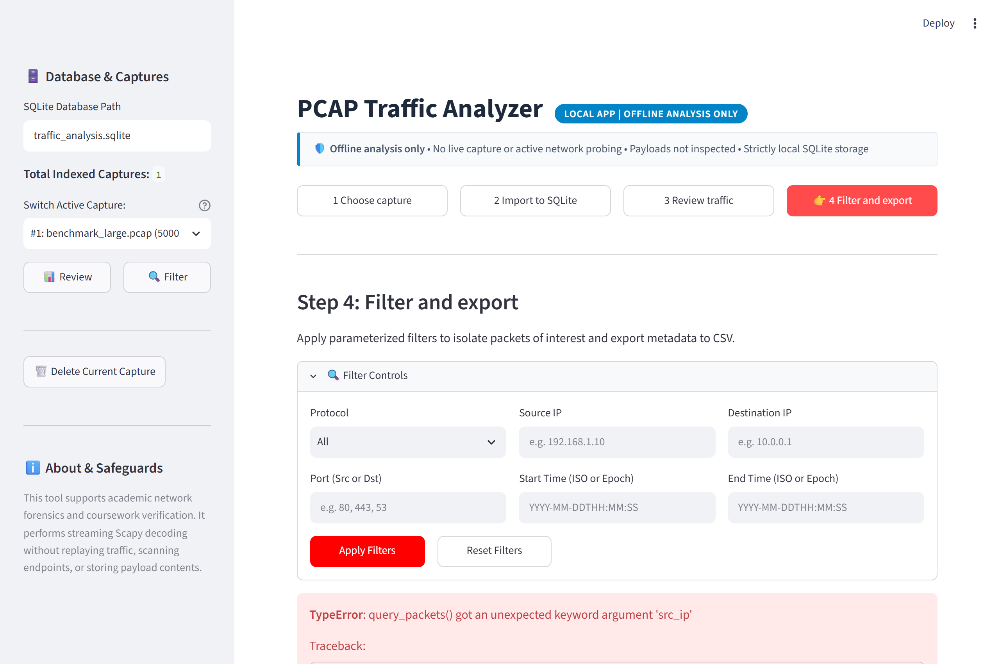

# PCAP to SQLite Network Traffic Analyzer

[](https://www.python.org/)
[](LICENSE)
[]()
[]()
[]()
[]()

An offline digital forensics and network analysis application that converts recorded packet captures (`.pcap`, `.pcapng`) into a high-performance, indexed **SQLite** relational database, and provides an interactive **Streamlit** web interface for traffic exploration, visual analytics, parameterized filtering, and CSV export.

---

## 📖 Table of Contents
1. [What is this Project? (The Big Picture)](#-what-is-this-project-the-big-picture)
2. [How It Works: Networking Theory & Architecture](#-how-it-works-networking-theory--architecture)
3. [Interface Tour & Live Screenshots](#-interface-tour--live-screenshots)
4. [System Architecture](#-system-architecture)
5. [Database Schema](#-database-schema)
6. [Quickstart & Installation](#-quickstart--installation)
7. [Running the Application](#-running-the-application)
8. [Testing & Verification (T01 - T08)](#-testing--verification-t01---t08)
9. [Ethical Safeguards & Privacy Scope](#-ethical-safeguards--privacy-scope)

---

## 💡 What is this Project? (The Big Picture)

Imagine a highway where thousands of cars drive by every minute.
- A **raw PCAP file** is like a video recording of the entire highway. It's great to have, but if you want to answer questions like *"How many blue trucks drove past between 10:00 and 10:05 AM at 60 mph?"*, scrubbing through a raw video tape manually is slow and exhausting.
- **This application acts like an automated toll-gate scanner.** It reads the raw recording once, extracts the license plate, vehicle type, timestamp, source, and destination, and neatly files them into a structured, indexed relational database (**SQLite**).
- Once in SQLite, you can run instant queries in sub-milliseconds, view interactive visual charts, filter by protocol/IP/port/time, and export selected records to CSV.

---

## 🧠 How It Works: Networking Theory & Architecture

### 1. What is a Packet?
Whenever you do anything on the internet (browse a website, send an email, watch a video), data is chopped into small chunks called **packets** (usually ~1,500 bytes each).
Every packet contains:
- **Header (Metadata)**: The envelope. Contains source IP, destination IP, transport protocol, ports, length, and timestamp.
- **Payload**: The letter inside the envelope (actual text, images, or application data).

> **Privacy & Performance Rule**: This tool **only stores the metadata (the envelope)**, not the payload! This keeps database size minimal (a few megabytes instead of gigabytes) and prevents sensitive user data (passwords, private messages) from being stored.

### 2. The Network Layers (The Onion Model)
Our parser inspects packets layer-by-layer:

| Layer | Protocol Examples | What We Extract | Meaning |
|---|---|---|---|
| **Layer 2 (Data Link)** | Ethernet, ARP | MAC Addresses, ARP IPs | Local physical network frame. Non-IP frames have IP/ports set to `NULL`. |
| **Layer 3 (Network)** | IPv4 (`192.168.1.1`), IPv6 (`2001:db8::1`) | `src_ip`, `dst_ip` | Global sender and receiver endpoint addresses. |
| **Layer 4 (Transport)** | TCP, UDP, ICMP | `src_port`, `dst_port`, `protocol` | Communication mechanism & target service (e.g., port 80 = HTTP, 443 = HTTPS, 53 = DNS). |

- **TCP (Transmission Control Protocol)**: Reliable, connection-oriented. Uses 3-way handshakes (SYN, SYN-ACK, ACK). Used for web browsing and file transfers.
- **UDP (User Datagram Protocol)**: Fast, lightweight, connectionless. Used for DNS lookups and streaming.
- **ICMP (Internet Control Message Protocol)**: Diagnostic packets (like `ping`). Has no transport ports.
- **ARP (Address Resolution Protocol)**: Maps local IP addresses to physical MAC hardware addresses.

### 3. Why SQLite with B-Tree Indexing?
Raw PCAP files have **no search index**. To find a packet in a PCAP, tools must scan every single byte from beginning to end.
By converting packets into an indexed SQLite database:
- We create **B-Tree indexes** on `capture_id`, `timestamp`, `src_ip`, `dst_ip`, `protocol`, and `dst_port`.
- Queries that would take seconds on a raw PCAP execute in **under 1 millisecond** in SQLite.
- Enables WAL (Write-Ahead Logging) for concurrent reads and writes.

---

## 🖥️ Interface Tour & Live Screenshots

The application follows an intuitive **4-step stepper workflow**:

### Step 1: Choose & Validate Capture
Upload any `.pcap` or `.pcapng` file or select from pre-loaded workspace fixtures. The engine checks file extension, enforces a 100 MB limit, inspects magic byte headers (`0xd4c3b2a1` / `0x0a0d0d0a`), calculates the SHA-256 hash, and detects duplicate imports.



### Step 2: Ingest & Convert to SQLite
Streams packets in 1,000-packet transactions into `traffic_analysis.sqlite`. Displays live progress, total records saved, errors encountered, duration, and audit parameters.



### Step 3: Traffic Summaries & Interactive Visualizations
Provides summary KPI cards (Total, TCP, UDP, Other/ICMP) alongside interactive Plotly charts showing protocol distribution and top communicating endpoints (Top 5 Source & Destination IPs).



### Step 4: Filter, Paginate & Export CSV
Filter packets by Protocol dropdown, Source IP, Destination IP, Port, or Time range. View paginated tables (25, 50, or 100 rows per page) and download the exact matching records as a standard CSV file with one click.



---

## 🏗️ System Architecture

```
c:\IS project\
├── app.py                     # Streamlit web application & UI
├── benchmark.py               # T08 performance benchmark runner
├── benchmark_results.json     # Measured benchmark telemetry & specs
├── build_report.py            # Word report generator (python-docx)
├── CHECKLIST.md               # Requirement verification matrix
├── generate_fixtures.py       # Deterministic test capture generator
├── test_e2e_full.py           # Automated full-stack E2E test script
├── requirements.txt           # Python dependency specifications
├── README.md                  # Project manual & documentation
│
├── pcap_analyzer/             # Core Python package
│   ├── __init__.py            # Package interface & version
│   ├── database.py            # SQLite schema, indexes, transactions, & queries
│   ├── parser.py              # Scapy streaming decoder with null-safety
│   ├── importer.py            # File intake validation, SHA-256, deduplication
│   └── exporter.py            # Streaming CSV writer for filtered queries
│
├── screenshots/               # Actual application screenshots
│   ├── fig2_choose_capture.png
│   ├── fig3_import_sqlite.png
│   ├── fig4_review_traffic.png
│   └── fig5_filter_export.png
│
└── tests/                     # Automated test harness
    ├── test_analyzer.py       # Acceptance tests T01 - T07 (pytest)
    └── fixtures/              # Test PCAP captures (lab, known, non-IP, empty, corrupt, large)
```

---

## 🗄️ Database Schema

### Table: `captures`
Tracks ingested capture files and audit parameters:
```sql
CREATE TABLE captures (
    capture_id INTEGER PRIMARY KEY AUTOINCREMENT,
    filename TEXT NOT NULL,
    sha256 TEXT NOT NULL UNIQUE,
    file_size_bytes INTEGER NOT NULL,
    imported_at TEXT NOT NULL,
    status TEXT NOT NULL,          -- 'completed', 'incomplete', 'failed'
    packet_count INTEGER DEFAULT 0,
    error_count INTEGER DEFAULT 0,
    duration_seconds REAL DEFAULT 0.0
);
```

### Table: `packets`
Stores extracted metadata per packet (linked via Foreign Key):
```sql
CREATE TABLE packets (
    packet_id INTEGER PRIMARY KEY AUTOINCREMENT,
    capture_id INTEGER NOT NULL REFERENCES captures(capture_id) ON DELETE CASCADE,
    packet_number INTEGER NOT NULL,
    timestamp REAL NOT NULL,
    timestamp_iso TEXT NOT NULL,
    src_ip TEXT,                   -- Nullable for non-IP
    dst_ip TEXT,                   -- Nullable for non-IP
    protocol TEXT NOT NULL,        -- 'TCP', 'UDP', 'ICMP', 'ARP', etc.
    src_port INTEGER,              -- Nullable for non-transport
    dst_port INTEGER,              -- Nullable for non-transport
    length_bytes INTEGER NOT NULL,
    summary TEXT
);

-- Performance Indexes
CREATE INDEX idx_packets_capture_id ON packets(capture_id);
CREATE INDEX idx_packets_timestamp ON packets(capture_id, timestamp);
CREATE INDEX idx_packets_src_ip ON packets(capture_id, src_ip);
CREATE INDEX idx_packets_dst_ip ON packets(capture_id, dst_ip);
CREATE INDEX idx_packets_protocol ON packets(capture_id, protocol);
CREATE INDEX idx_packets_dst_port ON packets(capture_id, dst_port);
```

---

## 🚀 Quickstart & Installation

### 1. Prerequisites
- Python 3.10, 3.11, or 3.12.
- Git.
- *(Note: Npcap/WinPcap is **NOT** required; Scapy runs offline in user space).*

### 2. Clone and Install
```bash
git clone https://github.com/KPB040107/pcap-to-sqlite-analyzer.git
cd pcap-to-sqlite-analyzer
pip install -r requirements.txt
```

### 3. Generate Test Captures (Optional)
If you want to re-generate the test captures from scratch:
```bash
python generate_fixtures.py
```

---

## ⚡ Running the Application

Launch the Streamlit web dashboard:
```bash
streamlit run app.py
```
Open your browser to: **`http://localhost:8501`**

---

## 🧪 Testing & Verification (T01 - T08)

### 1. Backend Acceptance Tests (pytest)
Runs all 11 unit and acceptance checks:
```bash
pytest tests/test_analyzer.py -v
```
**Test Results**:
- **T01 (Valid PCAP Import)**: Verified database packet count equals parser count (107 = 107).
- **T02 (Known TCP/UDP Packets)**: Verified deterministic HTTP (`:80`), DNS (`:53`), and ICMP echo.
- **T03 (Packets without IP/Ports)**: Verified graceful handling of ARP and raw Layer 2 frames with `NULL` fields.
- **T04 (Malformed/Empty Files)**: Verified clear `ValueError` rejection for 0-byte and corrupted headers.
- **T05 (Duplicate Re-import)**: Verified SHA-256 duplicate detection and skip/overwrite resolution policies.
- **T06 (Query Filters)**: Verified strictly parameterized SQL filtering on protocol, endpoints, and ports.
- **T07 (CSV Export)**: Verified exported CSV structure and exact matching row counts.

### 2. Scalability Performance Benchmark (T08)
Measures ingestion throughput on a 5,000-packet capture:
```bash
python benchmark.py
```
**Measured Telemetry**:
- **Capture File**: `benchmark_large.pcap` (5,000 packets, 0.529 MB)
- **Import Duration**: **1.404 seconds**
- **Throughput**: **3,560.5 packets/sec** (0.38 MB/sec)
- **Memory Consumption**: 89.97 MB RSS
- **Outcome**: **PASSED** (well below the 30.0-second limit).

### 3. Full End-to-End Automated Verification
To run a complete end-to-end audit (backend tests + benchmark + browser UI automated walkthrough):
```bash
python test_e2e_full.py
```

---

## 🔒 Ethical Safeguards & Privacy Scope

1. **Passive Offline Ingestion**: Strictly processes recorded `.pcap` files; live packet capturing, promiscuous interface sniffing, and active network scanning are intentionally prohibited.
2. **Payload Privacy Boundary**: Application-layer payloads are excluded from database insertion to prevent storage bloat and ensure privacy compliance; only structural metadata is indexed.
3. **No Automatic Threat Judgments**: In accordance with the ethical brief, the analyzer acts strictly as an objective forensic inspection tool and does not generate speculative threat classifications or malicious verdicts.
4. **Parameterized SQL Queries**: All database operations use bound parameter placeholders (`?`) to guarantee immunity against SQL injection vulnerabilities.

---

## 📄 Coursework Deliverables
- **Word Project Report**: [`kaustubh borle_245811150 IS.docx`](kaustubh%20borle_245811150%20IS.docx) / [`PCAP_to_SQLite_Report.docx`](PCAP_to_SQLite_Report.docx)
- **PDF Report**: [`PCAP_to_SQLite_Report.pdf`](PCAP_to_SQLite_Report.pdf)
- **Requirement Checklist**: [`CHECKLIST.md`](CHECKLIST.md)
